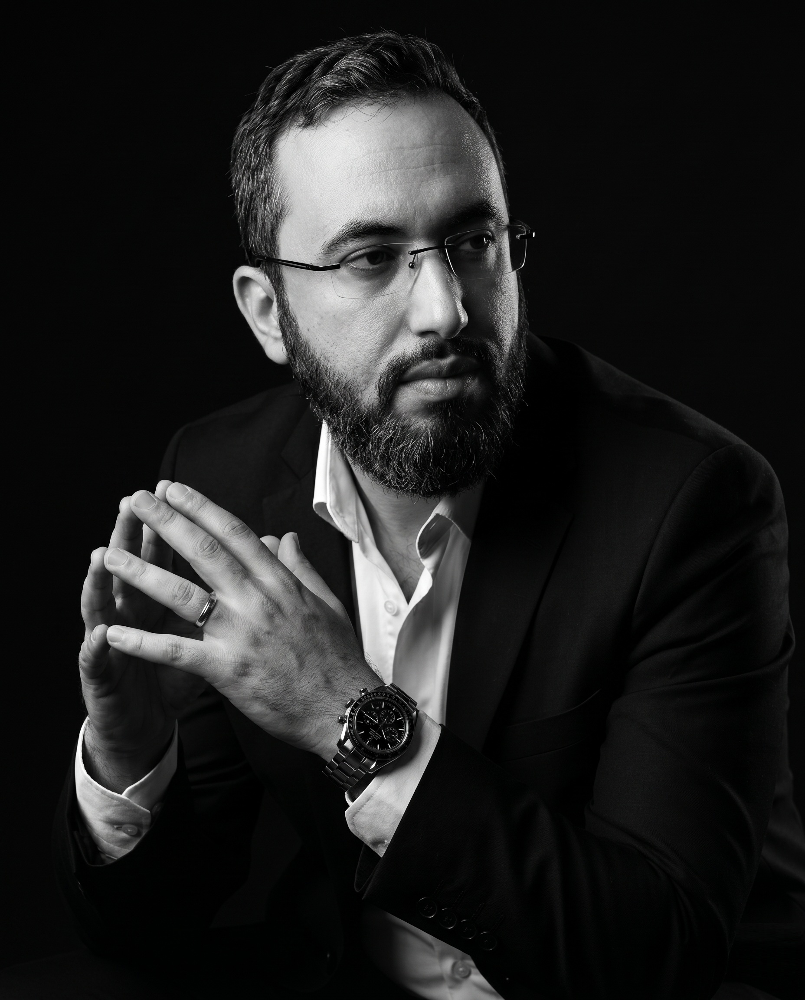
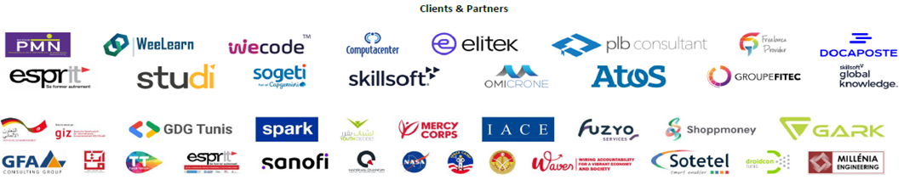

# Votre formateur

## Houssem Eddine LASSOUED

**Expert IA & Ingénierie Logicielle**

- CEO de National Quantum (IT & IA)
- Ingénieur IT et doctorant en IA
- Développeur Senior (Java, Python) depuis 18 ans
- Chercheur et enseignant universitaire
- Consultant en transformation numérique
- Formateur professionnel depuis 8 ans avec plus de 250 formations assurées pour plus de 60 entreprises et environ 3000 participants

### Liens

- LinkedIn : <https://linkedin.com/in/houssemeddinelassoued>
- GitHub : <https://github.com/houssemeddinelassoued>

## Clients & Partners

PMN · WeeLearn · wecode · Computacenter · elitek · PLB Consultant · Freelance Provider · Docaposte · ESPRIT · Studi · Sogeti (Capgemini) · Skillsoft · Omicrone · Atos · Groupe FITEC · Skillsoft Global Knowledge · GIZ · GDG Tunis · Spark · Mercy Corps · IACE · Fuzyo Services · Shoppmoney · GARK · GFA Consulting Group · Tunisie Telecom · ESPRIT · Sanofi · National Quantum · NASA · Waves · Sotetel · droidcon Tunis · Millénia Engineering

## Visuels

| Fichier | Contenu |
|---|---|
| [Houssem-Eddine-Lassoued.jpg](Houssem-Eddine-Lassoued.jpg) | Portrait |
| [clients.png](clients.png) | Logos clients et partenaires |
