<div align="center">

# Comprendre l'IA, une slide à la fois

**25 présentations interactives en français, plus de 1 100 pages : des formations IA complètes, des explications visuelles et une série sur l'histoire de l'IA.**<br>
Chaque page est un composant React, chaque schéma est calculé, chaque clic révèle une étape.

[](https://github.com/houssemeddinelassoued/my-deck/actions/workflows/deploy-pages.yml)


### [▶ Ouvrir toutes les présentations en ligne](https://houssemeddinelassoued.github.io/my-deck/)

<a href="https://houssemeddinelassoued.github.io/my-deck/s/ia-agentique-feuille-de-route">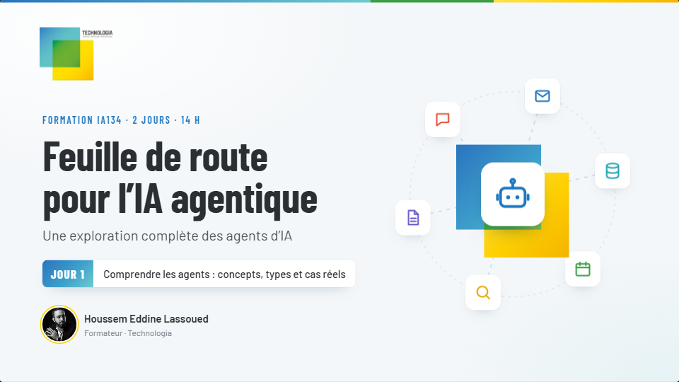</a>
<a href="https://houssemeddinelassoued.github.io/my-deck/s/ml-explique">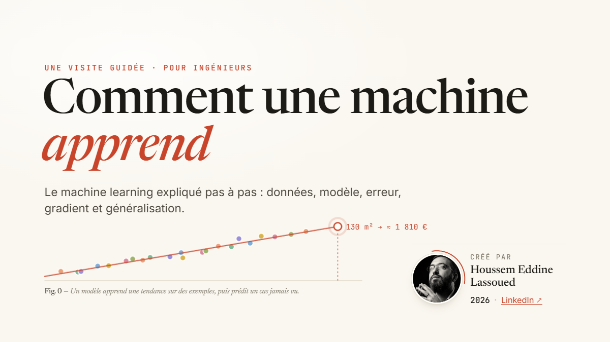</a>
<a href="https://houssemeddinelassoued.github.io/my-deck/s/ai-history-sommaire">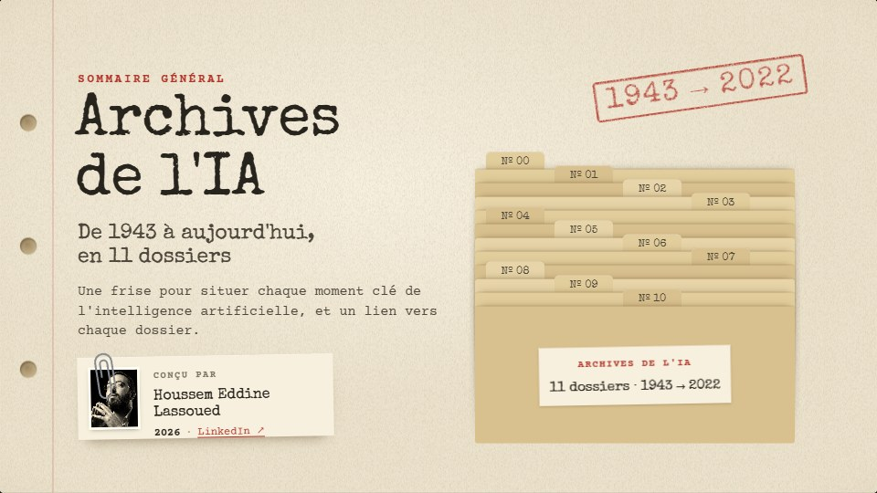</a>

</div>

---

## Sommaire

- [Catalogue](#catalogue)
  - [Formations IA](#formations-ia)
  - [Comprendre l'IA](#comprendre-lia)
  - [Archives de l'IA](#archives-de-lia)
  - [Autres présentations](#autres-présentations)
- [Galerie](#galerie)
- [Zoom sur quelques présentations](#zoom-sur-quelques-présentations)
- [Présenter](#présenter)
- [Lancer en local](#lancer-en-local)
- [Structure du dépôt](#structure-du-dépôt)
- [Présentations générées](#présentations-générées)
- [Déploiement](#déploiement)
- [Créer une présentation](#créer-une-présentation)

---

## Catalogue

Toutes les présentations sont en ligne sur **<https://houssemeddinelassoued.github.io/my-deck/>**. Chaque ligne donne un lien direct vers la présentation (▶) et vers sa vue présentateur (🎤), qui affiche les notes de l'orateur.

### Formations IA

Des formations d'une ou deux journées, prêtes à animer : modules minutés, ateliers avec chronomètre, quiz, simulateurs interactifs, un fil rouge d'entreprise du début à la fin, et les notes du formateur sur chaque page.

| Formation | Durée | Pages | Pour qui | Liens |
| --- | :---: | :---: | --- | --- |
| **Feuille de route pour l'IA agentique** (Technologia IA134)<br><sub>`slides/ia-agentique-feuille-de-route` · fil rouge : Boréal Distribution</sub> | 2 j · 14 h | 112 | Gestionnaires, analystes, TI et chefs de projet qui bâtissent une feuille de route d'agents IA | [▶ Ouvrir](https://houssemeddinelassoued.github.io/my-deck/s/ia-agentique-feuille-de-route) · [🎤](https://houssemeddinelassoued.github.io/my-deck/s/ia-agentique-feuille-de-route/presenter) |
| **Développeurs · Boostez vos performances grâce à l'IA** (Docaposte Institute)<br><sub>`slides/docaposte-dev-ia` · TP : FrigoMalin</sub> | 2 j · 14 h | 130 | Développeurs : Copilot, agents, sécurité et qualité du code | [▶ Ouvrir](https://houssemeddinelassoued.github.io/my-deck/s/docaposte-dev-ia) · [🎤](https://houssemeddinelassoued.github.io/my-deck/s/docaposte-dev-ia/presenter) |
| **GitHub Copilot · Niveau avancé**<br><sub>`slides/copilot-avance` · TP : l'API SalleLibre, en TS, Python, Java ou C#</sub> | 1 j · 7 h | 68 | Développeurs qui utilisent déjà Copilot | [▶ Ouvrir](https://houssemeddinelassoued.github.io/my-deck/s/copilot-avance) · [🎤](https://houssemeddinelassoued.github.io/my-deck/s/copilot-avance/presenter) |
| **IA avancée & automatisation**<br><sub>`slides/ia-avancee-automatisation` · un cas concret par module</sub> | 2 j · 14 h | 134 | Profils métier qui veulent automatiser leurs processus avec l'IA | [▶ Ouvrir](https://houssemeddinelassoued.github.io/my-deck/s/ia-avancee-automatisation) · [🎤](https://houssemeddinelassoued.github.io/my-deck/s/ia-avancee-automatisation/presenter) |
| **Les 20 outils IA qui font gagner du temps**<br><sub>`slides/outils-ia-gain-de-temps` · une page par outil</sub> | 1 j · 7 h | 102 | Tous publics, sans prérequis | [▶ Ouvrir](https://houssemeddinelassoued.github.io/my-deck/s/outils-ia-gain-de-temps) · [🎤](https://houssemeddinelassoued.github.io/my-deck/s/outils-ia-gain-de-temps/presenter) |
| **IA pour l'assistant administratif**<br><sub>`slides/ia-assistant-administratif` · fil rouge : Nadia, aux Ateliers Morel</sub> | 1 j · 7 h | 76 | Assistants administratifs et de direction, débutants | [▶ Ouvrir](https://houssemeddinelassoued.github.io/my-deck/s/ia-assistant-administratif) · [🎤](https://houssemeddinelassoued.github.io/my-deck/s/ia-assistant-administratif/presenter) |
| **IA pour les ressources humaines**<br><sub>`slides/ia-pour-les-rh` · fil rouge : la PME Solvéa</sub> | 1 j · 7 h | 83 | Équipes RH, débutants | [▶ Ouvrir](https://houssemeddinelassoued.github.io/my-deck/s/ia-pour-les-rh) · [🎤](https://houssemeddinelassoued.github.io/my-deck/s/ia-pour-les-rh/presenter) |
| **IA pour le marketing & la communication**<br><sub>`slides/ia-marketing-communication` · fil rouge : le torréfacteur Ardente</sub> | 1 j · 7 h | 89 | Équipes marketing et communication, débutants | [▶ Ouvrir](https://houssemeddinelassoued.github.io/my-deck/s/ia-marketing-communication) · [🎤](https://houssemeddinelassoued.github.io/my-deck/s/ia-marketing-communication/presenter) |
| **IA pour la relation client**<br><sub>`slides/ia-relation-client` · fil rouge : l'enseigne Nova Maison</sub> | 1 j · 7 h | 103 | Conseillers et managers de la relation client, débutants | [▶ Ouvrir](https://houssemeddinelassoued.github.io/my-deck/s/ia-relation-client) · [🎤](https://houssemeddinelassoued.github.io/my-deck/s/ia-relation-client/presenter) |

### Comprendre l'IA

Des présentations courtes qui démontent un mécanisme pas à pas, avec des schémas calculés dans la slide.

| Présentation | Pages | Pour qui | Liens |
| --- | :---: | --- | --- |
| **Comment une machine apprend**<br><sub>`slides/ml-explique`</sub> | 22 | Ingénieurs qui veulent comprendre le machine learning de l'intérieur | [▶ Ouvrir](https://houssemeddinelassoued.github.io/my-deck/s/ml-explique) · [🎤](https://houssemeddinelassoued.github.io/my-deck/s/ml-explique/presenter) |
| **Comment fonctionne un LLM**<br><sub>`slides/llm-explique`</sub> | 20 | Ingénieurs curieux de ce qui se passe entre le prompt et la réponse | [▶ Ouvrir](https://houssemeddinelassoued.github.io/my-deck/s/llm-explique) · [🎤](https://houssemeddinelassoued.github.io/my-deck/s/llm-explique/presenter) |
| **La fenêtre de contexte, expliquée avec un bureau**<br><sub>`slides/fenetre-de-contexte`</sub> | 20 | Développeurs qui utilisent Copilot, Cursor ou ChatGPT au quotidien | [▶ Ouvrir](https://houssemeddinelassoued.github.io/my-deck/s/fenetre-de-contexte) · [🎤](https://houssemeddinelassoued.github.io/my-deck/s/fenetre-de-contexte/presenter) |

### Archives de l'IA

Une série de 11 dossiers, de 1943 à 2022, chacun mis en scène comme un dossier d'archives : fiches, tampons, photos d'époque. Le **sommaire** présente la frise complète et renvoie vers chaque dossier. Tous publics.

| N° | Année | Dossier | Pages | Liens |
| :---: | :---: | --- | :---: | --- |
| — | 1943 → 2022 | **Sommaire général**<br><sub>`slides/ai-history-sommaire`</sub> | 9 | [▶ Ouvrir](https://houssemeddinelassoued.github.io/my-deck/s/ai-history-sommaire) · [🎤](https://houssemeddinelassoued.github.io/my-deck/s/ai-history-sommaire/presenter) |
| 00 | 1943 | **Le neurone formel** : le premier modèle mathématique du neurone | 10 | [▶ Ouvrir](https://houssemeddinelassoued.github.io/my-deck/s/ai-history-00-neurone-formel) · [🎤](https://houssemeddinelassoued.github.io/my-deck/s/ai-history-00-neurone-formel/presenter) |
| 01 | 1957 | **Le Perceptron** : la machine qui apprend | 20 | [▶ Ouvrir](https://houssemeddinelassoued.github.io/my-deck/s/ai-history-01-perceptron) · [🎤](https://houssemeddinelassoued.github.io/my-deck/s/ai-history-01-perceptron/presenter) |
| 02 | 1986 | **La rétropropagation** : corriger chaque poids d'un réseau | 14 | [▶ Ouvrir](https://houssemeddinelassoued.github.io/my-deck/s/ai-history-02-retropropagation) · [🎤](https://houssemeddinelassoued.github.io/my-deck/s/ai-history-02-retropropagation/presenter) |
| 03 | 1956 | **L'IA symbolique** : règles, symboles et hivers | 13 | [▶ Ouvrir](https://houssemeddinelassoued.github.io/my-deck/s/ai-history-03-ia-symbolique) · [🎤](https://houssemeddinelassoued.github.io/my-deck/s/ai-history-03-ia-symbolique/presenter) |
| 04 | 1989 | **Apprendre à voir** : les réseaux convolutifs | 13 | [▶ Ouvrir](https://houssemeddinelassoued.github.io/my-deck/s/ai-history-04-reseaux-convolutifs) · [🎤](https://houssemeddinelassoued.github.io/my-deck/s/ai-history-04-reseaux-convolutifs/presenter) |
| 05 | 1997 | **Deep Blue bat Kasparov** : la victoire du calcul | 10 | [▶ Ouvrir](https://houssemeddinelassoued.github.io/my-deck/s/ai-history-05-deep-blue) · [🎤](https://houssemeddinelassoued.github.io/my-deck/s/ai-history-05-deep-blue/presenter) |
| 06 | 2012 | **AlexNet et ImageNet** : le big bang du deep learning | 12 | [▶ Ouvrir](https://houssemeddinelassoued.github.io/my-deck/s/ai-history-06-alexnet) · [🎤](https://houssemeddinelassoued.github.io/my-deck/s/ai-history-06-alexnet/presenter) |
| 07 | 2013 | **Les mots deviennent des nombres** : word2vec et la mémoire des réseaux | 12 | [▶ Ouvrir](https://houssemeddinelassoued.github.io/my-deck/s/ai-history-07-word2vec) · [🎤](https://houssemeddinelassoued.github.io/my-deck/s/ai-history-07-word2vec/presenter) |
| 08 | 2016 | **AlphaGo** : apprendre en jouant | 12 | [▶ Ouvrir](https://houssemeddinelassoued.github.io/my-deck/s/ai-history-08-alphago) · [🎤](https://houssemeddinelassoued.github.io/my-deck/s/ai-history-08-alphago/presenter) |
| 09 | 2017 | **Le Transformer** : « Attention Is All You Need » | 12 | [▶ Ouvrir](https://houssemeddinelassoued.github.io/my-deck/s/ai-history-09-transformer) · [🎤](https://houssemeddinelassoued.github.io/my-deck/s/ai-history-09-transformer/presenter) |
| 10 | 2022 | **ChatGPT** : l'IA générative pour tous | 10 | [▶ Ouvrir](https://houssemeddinelassoued.github.io/my-deck/s/ai-history-10-chatgpt) · [🎤](https://houssemeddinelassoued.github.io/my-deck/s/ai-history-10-chatgpt/presenter) |

### Autres présentations

| Présentation | Pages | Pour qui | Liens |
| --- | :---: | --- | --- |
| **Lesson 4 · Meet my classmates**<br><sub>`slides/meet-my-classmates`</sub> | 21 | Cours d'anglais, 5ᵉ année du primaire | [▶ Ouvrir](https://houssemeddinelassoued.github.io/my-deck/s/meet-my-classmates) · [🎤](https://houssemeddinelassoued.github.io/my-deck/s/meet-my-classmates/presenter) |
| **Getting started**<br><sub>`slides/getting-started`</sub> | 18 | Démo fournie par le framework open-slide | [▶ Ouvrir](https://houssemeddinelassoued.github.io/my-deck/s/getting-started) |

---

## Galerie

Cliquez sur une couverture pour ouvrir la présentation.

<table>
  <tr>
    <td width="33%" align="center"><a href="https://houssemeddinelassoued.github.io/my-deck/s/ia-agentique-feuille-de-route"></a><br><sub><b>IA agentique</b> · 112 p.</sub></td>
    <td width="33%" align="center"><a href="https://houssemeddinelassoued.github.io/my-deck/s/docaposte-dev-ia">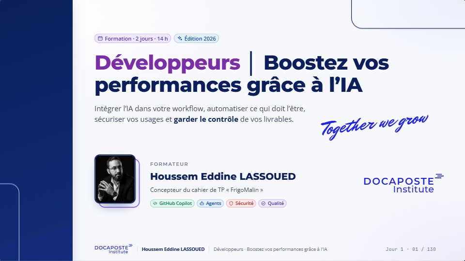</a><br><sub><b>Développeurs & IA</b> · 130 p.</sub></td>
    <td width="33%" align="center"><a href="https://houssemeddinelassoued.github.io/my-deck/s/copilot-avance">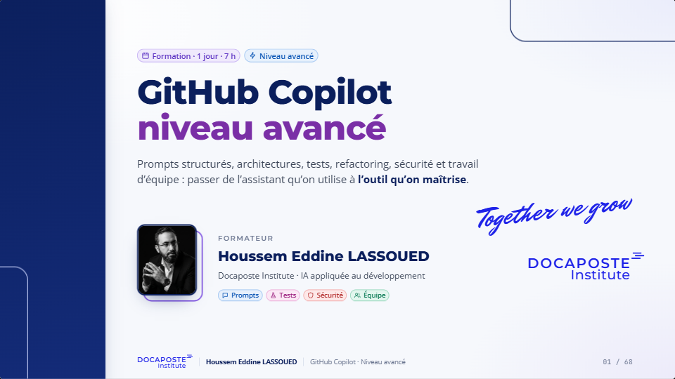</a><br><sub><b>Copilot avancé</b> · 68 p.</sub></td>
  </tr>
  <tr>
    <td align="center"><a href="https://houssemeddinelassoued.github.io/my-deck/s/ia-avancee-automatisation">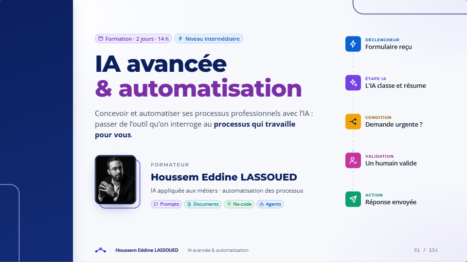</a><br><sub><b>IA avancée & automatisation</b> · 134 p.</sub></td>
    <td align="center"><a href="https://houssemeddinelassoued.github.io/my-deck/s/outils-ia-gain-de-temps">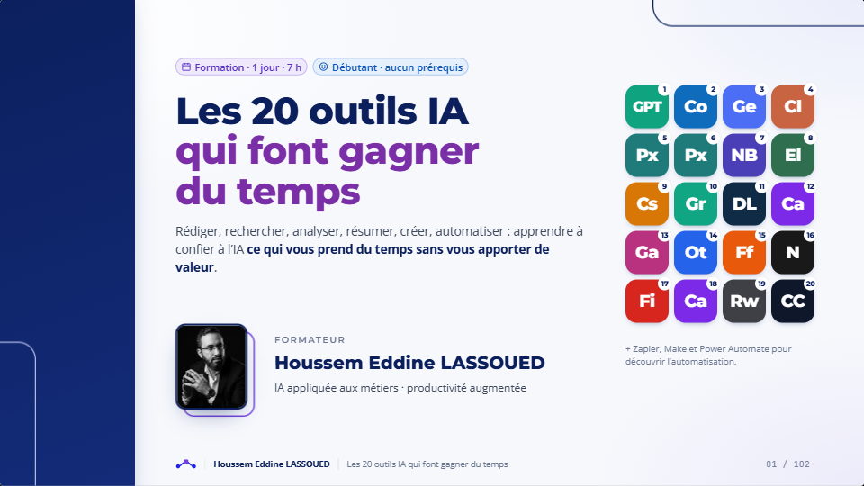</a><br><sub><b>20 outils IA</b> · 102 p.</sub></td>
    <td align="center"><a href="https://houssemeddinelassoued.github.io/my-deck/s/ia-assistant-administratif">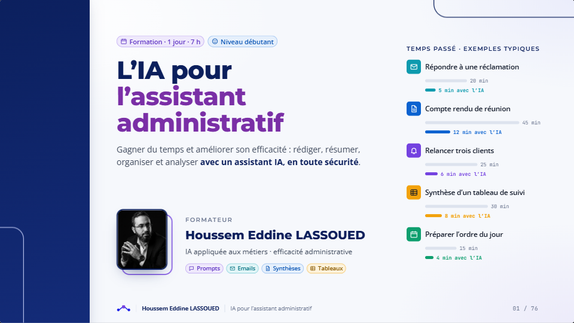</a><br><sub><b>Assistant administratif</b> · 76 p.</sub></td>
  </tr>
  <tr>
    <td align="center"><a href="https://houssemeddinelassoued.github.io/my-deck/s/ia-pour-les-rh">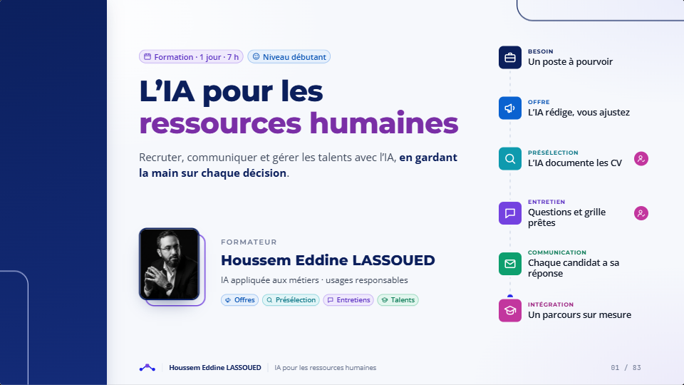</a><br><sub><b>Ressources humaines</b> · 83 p.</sub></td>
    <td align="center"><a href="https://houssemeddinelassoued.github.io/my-deck/s/ia-marketing-communication"></a><br><sub><b>Marketing & communication</b> · 89 p.</sub></td>
    <td align="center"><a href="https://houssemeddinelassoued.github.io/my-deck/s/ia-relation-client">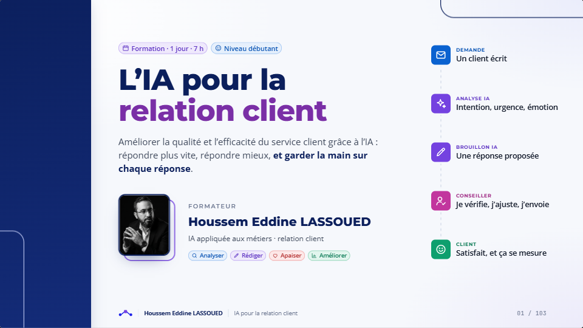</a><br><sub><b>Relation client</b> · 103 p.</sub></td>
  </tr>
  <tr>
    <td align="center"><a href="https://houssemeddinelassoued.github.io/my-deck/s/ml-explique"></a><br><sub><b>Comment une machine apprend</b> · 22 p.</sub></td>
    <td align="center"><a href="https://houssemeddinelassoued.github.io/my-deck/s/llm-explique">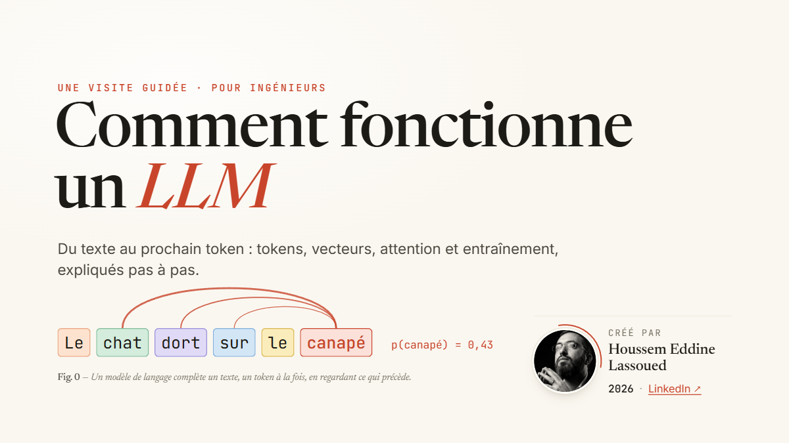</a><br><sub><b>Comment fonctionne un LLM</b> · 20 p.</sub></td>
    <td align="center"><a href="https://houssemeddinelassoued.github.io/my-deck/s/fenetre-de-contexte">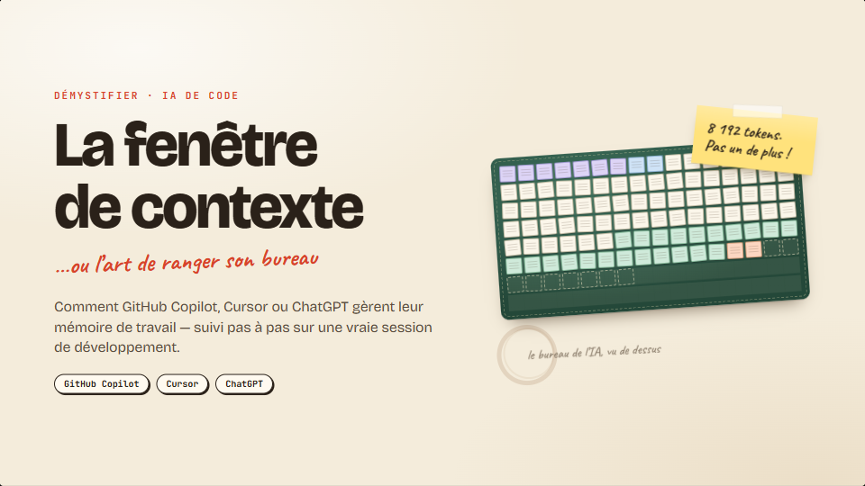</a><br><sub><b>La fenêtre de contexte</b> · 20 p.</sub></td>
  </tr>
  <tr>
    <td align="center"><a href="https://houssemeddinelassoued.github.io/my-deck/s/ai-history-sommaire"></a><br><sub><b>Archives de l'IA</b> · 12 présentations</sub></td>
    <td align="center"><a href="https://houssemeddinelassoued.github.io/my-deck/s/ai-history-01-perceptron">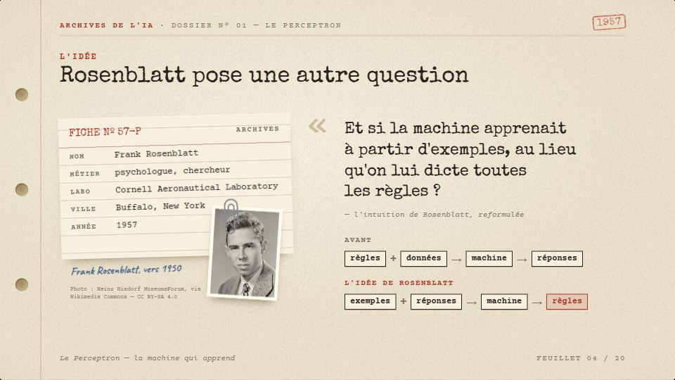</a><br><sub><b>Dossier 01 · Le Perceptron</b> · 20 p.</sub></td>
    <td align="center"><a href="https://houssemeddinelassoued.github.io/my-deck/s/meet-my-classmates">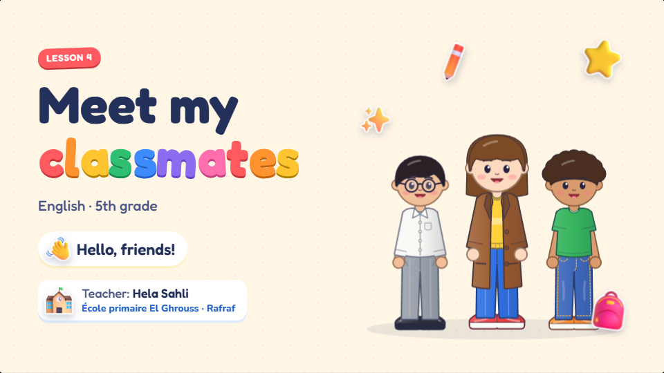</a><br><sub><b>Meet my classmates</b> · 21 p.</sub></td>
  </tr>
</table>

---

## Zoom sur quelques présentations

### Feuille de route pour l'IA agentique (IA134)

Formation de 2 jours qui suit le [programme officiel Technologia](https://www.technologia.com/formations/feuille-de-route-pour-lia-agentique---une-exploration-complete-des-agents-dia) : 10 modules (Jour 1 : comprendre les agents · Jour 2 : construire la feuille de route), avec QCM, ateliers minutés, simulateurs interactifs, un fil rouge (Boréal Distribution) et les notes du formateur sur chaque page.

 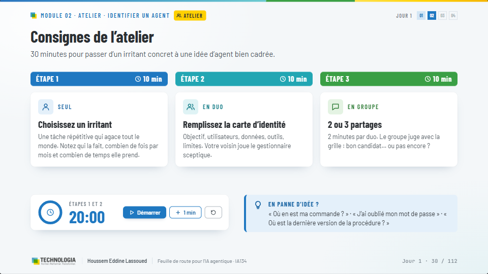

### Les formations métier (1 journée)

Assistant administratif, RH, marketing & communication, relation client, 20 outils IA : ces cinq formations partagent la même structure. On commence par situer l'IA dans le métier, puis chaque module traite une tâche concrète (rédiger une offre d'emploi, répondre à une réclamation, décliner une idée en contenus…) et se termine par un atelier. Une entreprise fictive sert de fil rouge et revient dans les exemples, jusqu'au cas final. La formation **20 outils IA** consacre une page à chaque outil : fonctions clés, exemple de prompt et de réponse, points de vigilance.

### GitHub Copilot · Niveau avancé

Six modules : prompt engineering avancé, modules et architectures, tests automatisés, optimisation et refactoring, sécurité et audit du code généré, Copilot en équipe. Les TP portent sur une même API REST de réservation de salles (SalleLibre), au choix en TypeScript, Python, Java ou C#.

 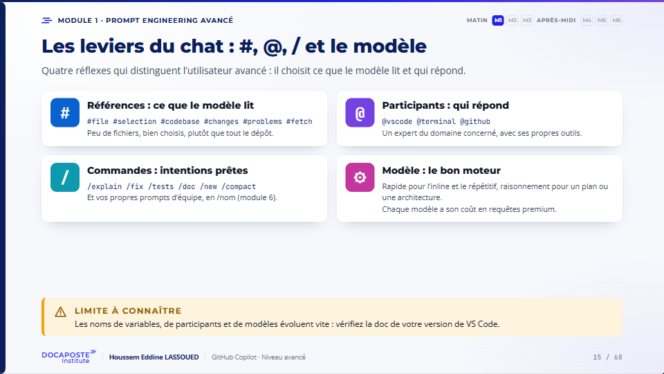

### La fenêtre de contexte, expliquée avec un bureau

La fenêtre de contexte d'un assistant de code, représentée par un bureau couvert de feuilles : chaque feuille vaut 64 tokens. On suit une vraie session de développement, prompt après prompt, jusqu'à la saturation, puis on voit comment ranger le bureau.

 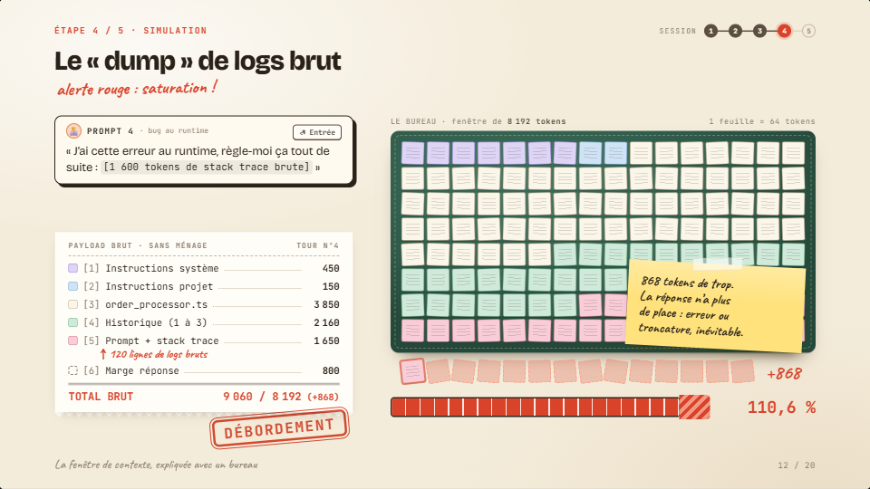

### Archives de l'IA

Chaque dossier raconte un moment clé : le contexte, l'idée, comment elle fonctionne (avec un schéma animé), et ce qu'elle a changé. Les photos d'époque sont créditées sur la page, avec leur source et leur licence.

 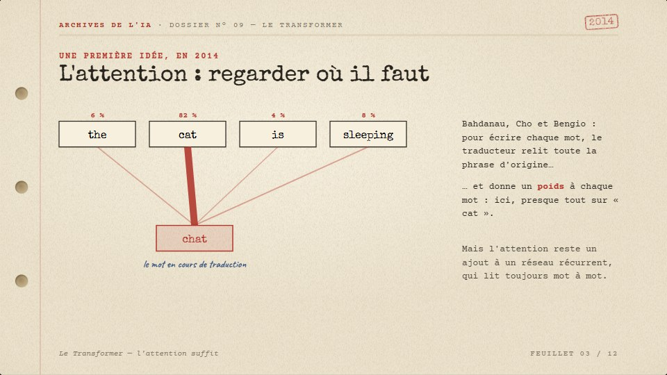

### Comment une machine apprend · Comment fonctionne un LLM

Ces deux présentations partagent la même direction artistique : papier et encre, titres en Newsreader, texte en Inter, code en JetBrains Mono, un rouge brique comme accent. Chacune a ses **notes de l'orateur** complètes, page par page, avec les repères de clics.

#### Comment une machine apprend

Un fil rouge du début à la fin : **prédire le loyer d'un appartement à partir de sa surface**. Puis un second exemple, la détection de spam, pour la classification.

| Chapitre | Ce qu'on y voit |
| --- | --- |
| **Introduction** | Programmer ou apprendre · supervisé, non supervisé, par renforcement · la recette en six étapes |
| **01 · Données** | Un jeu de données est un tableau (x, y) · encoder catégories, images et échelles |
| **02 · Modèle** | Une droite ŷ = w·x + b et ses réglages · classer avec une frontière et une sigmoïde |
| **03 · Erreur** | Les résidus et la MSE, dessinée en carrés · le paysage de l'erreur |
| **04 · Optimisation** | La descente de gradient, pas à pas · le taux d'apprentissage η · les mini-lots (SGD) |
| **05 · Généralisation** | Entraînement / validation / test · sous- et sur-apprentissage · courbes d'apprentissage · précision et rappel |
| **06 · Au-delà** | Arbres de décision · réseaux de neurones · k-means |
| **Conclusion** | Biais, corrélation ≠ causalité, dérive des données |

Les données sont fictives, mais **tous les chiffres affichés sont calculés dans la slide** : la droite des moindres carrés (w ≈ 12,2 €/m²), les erreurs de test des polynômes de degré 1, 3 et 9, les itérations de k-means…

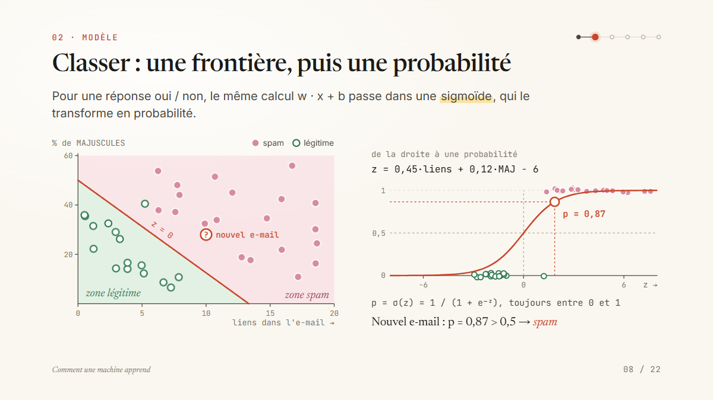 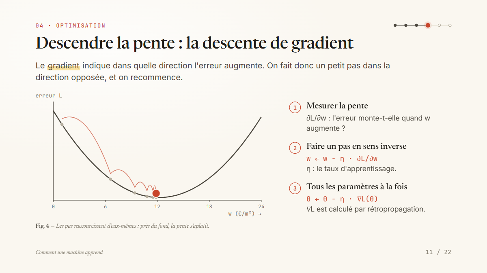
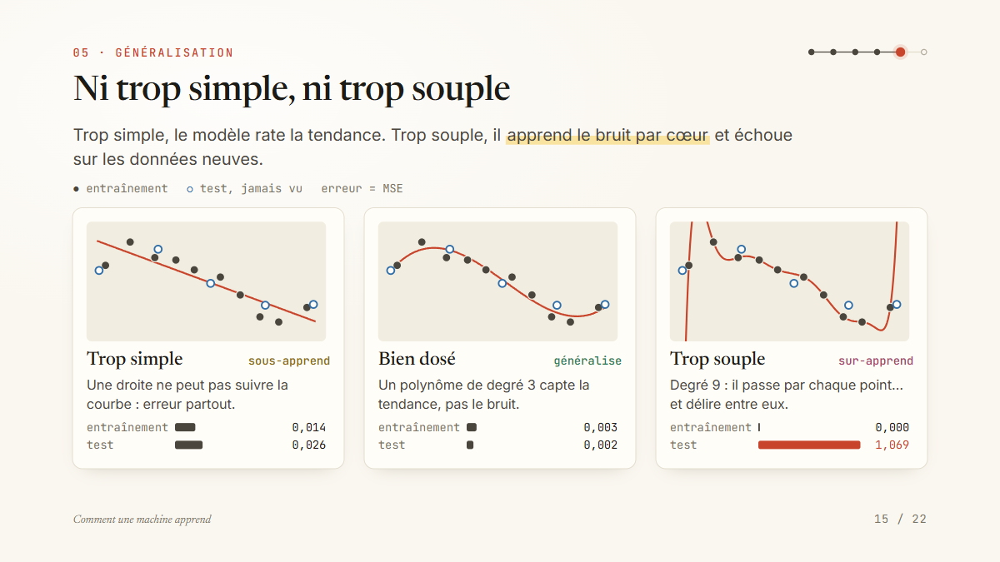 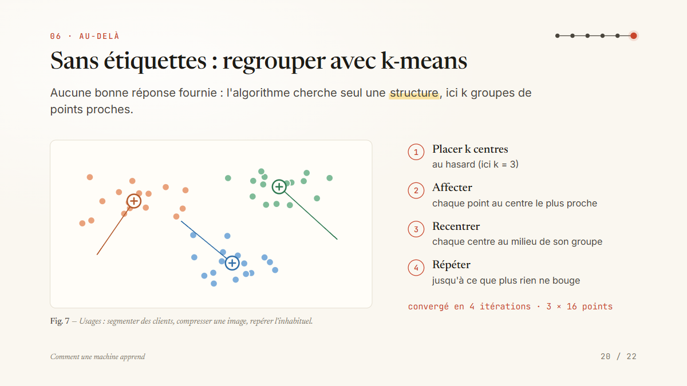

#### Comment fonctionne un LLM

Une seule phrase suivie de bout en bout : **« Le chat dort sur le… »**, jusqu'au token suivant.

| Chapitre | Ce qu'on y voit |
| --- | --- |
| **Introduction** | Une seule tâche : prédire le token suivant · le voyage d'une phrase |
| **01 · Tokens** | Découper le texte en tokens |
| **02 · Vecteurs** | Embeddings · le sens devient géométrie · en 3D, puis en milliers de dimensions |
| **03 · Attention** | Un même mot, plusieurs sens · requête, clé, valeur · la matrice d'attention · les têtes multiples |
| **04 · Transformer** | Un bloc, empilé N fois |
| **05 · Prédiction** | Des logits au prochain token · la température · la boucle autorégressive |
| **06 · Entraînement** | Le pré-entraînement · du compléteur de texte à l'assistant |
| **Conclusion** | Ce que ce mécanisme implique |

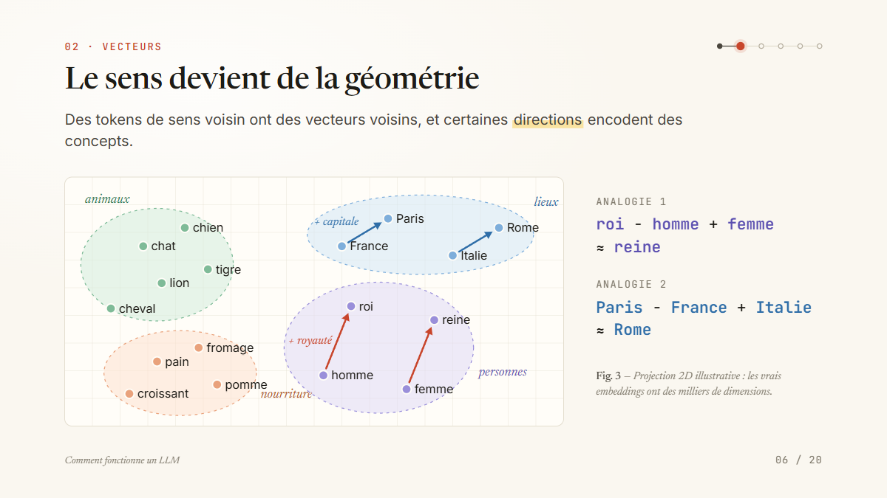 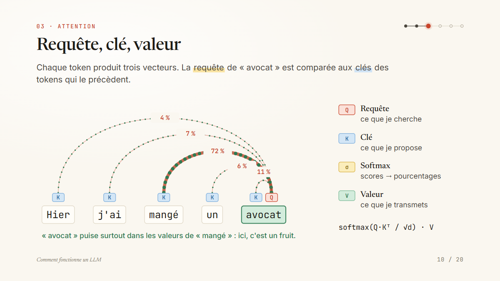 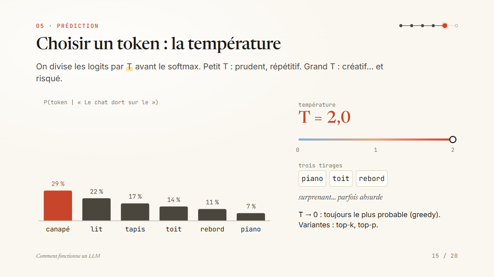

---

## Présenter

Ouvrez une présentation, puis le menu **Present** : **Play** (dans la fenêtre), **Fullscreen**, ou **Presenter mode**. Beaucoup de pages se construisent clic par clic : chaque **→** révèle l'étape suivante avant de passer à la page d'après. Une touche maintenue enfoncée (ou le bouton d'une télécommande) n'avance que d'une étape à la fois.

| Touche | Action |
| --- | --- |
| `→` · `Espace` / `←` | Étape ou page suivante / précédente |
| `F` | Lancer en plein écran |
| `O` | Vue d'ensemble des pages |
| `P` | Ouvrir la vue présentateur |
| `B` · `W` | Écran noir · écran blanc |
| `L` | Pointeur laser |
| `?` | Aide des raccourcis |
| `Esc` | Fermer / quitter |

La **vue présentateur** affiche les notes de l'orateur, la page suivante et un minuteur. Ouvrez-la dans une seconde fenêtre du même navigateur : elle suit la présentation. Pour démarrer directement à une page précise, ajoutez `?p=<numéro>` au lien (par exemple [`/s/ml-explique?p=11`](https://houssemeddinelassoued.github.io/my-deck/s/ml-explique?p=11)).

### En ligne ou en local ?

Le site GitHub Pages est la version **statique** : idéale pour présenter et partager. Les outils d'édition d'open-slide (inspecteur, panneau Design, gestion des images, modification des notes, dossiers) ont besoin du serveur de développement, donc d'une installation locale.

| | GitHub Pages | `npm run dev` |
| --- | :---: | :---: |
| Lire, naviguer, plein écran, vue présentateur | ✅ | ✅ |
| Lire les notes de l'orateur | ✅ | ✅ |
| Modifier les slides avec rechargement à chaud | — | ✅ |
| Inspecteur, panneau Design, assets | — | ✅ |
| Ranger les présentations en dossiers, les protéger par mot de passe | — | ✅ |

---

## Lancer en local

Prérequis : **Node.js 22.12+** (ou 20.19+).

```bash
git clone https://github.com/houssemeddinelassoued/my-deck.git
cd my-deck
npm install
npm run dev
```

Puis ouvrez <http://localhost:5173>.

| Commande | Rôle |
| --- | --- |
| `npm run dev` | Serveur de développement avec rechargement à chaud et outils d'édition |
| `npm run build` | Génère le site statique dans `dist/` |
| `npm run preview` | Sert le build localement pour le vérifier |
| `npm run patch:core` | Réapplique le correctif local d'open-slide (lancé automatiquement après `npm install`) |

> [!NOTE]
> `@open-slide/core` est figé en **2.0.1** et corrigé localement par [`patches/open-slide-core-2.0.1-folders.patch`](patches/open-slide-core-2.0.1-folders.patch) : il ajoute le rangement des présentations en dossiers sur la page d'accueil et la protection d'un dossier par mot de passe. Le script `postinstall` réapplique ce correctif après chaque installation. Ne mettez pas à jour le framework sans régénérer le correctif.

## Structure du dépôt

```text
my-deck/
├── slides/
│   ├── .folders.json                   # dossiers de la page d'accueil (« FORMATIONS IA »…)
│   ├── ia-agentique-feuille-de-route/  # formation IA134            ┐
│   ├── docaposte-dev-ia/               # Développeurs & IA          │
│   ├── copilot-avance/                 # Copilot niveau avancé      │
│   ├── ia-avancee-automatisation/      # IA avancée & automatisation│ générées
│   ├── outils-ia-gain-de-temps/        # 20 outils IA               │ (voir plus bas)
│   ├── ia-assistant-administratif/     # assistant administratif    │
│   ├── ia-pour-les-rh/                 # ressources humaines        │
│   ├── ia-marketing-communication/     # marketing & communication  │
│   ├── ia-relation-client/             # relation client            ┘
│   ├── ml-explique/                    # Comment une machine apprend
│   │   ├── index.tsx                   #   les pages + les notes de l'orateur
│   │   └── assets/                     #   images propres à la présentation
│   ├── llm-explique/                   # Comment fonctionne un LLM
│   ├── fenetre-de-contexte/            # La fenêtre de contexte
│   ├── ai-history-*/                   # Archives de l'IA (sommaire + 11 dossiers)
│   ├── meet-my-classmates/             # cours d'anglais
│   └── getting-started/                # démo du framework
├── .ia134-build/ .dap-build/ …         # sources des présentations générées
├── assets/                             # images partagées entre présentations
├── themes/                             # thèmes réutilisables
├── patches/ · scripts/                 # correctif local d'open-slide et son script
├── docs/preview/                       # captures utilisées dans ce README
├── .github/workflows/                  # déploiement GitHub Pages
├── .claude/skills/                     # skills Claude Code pour créer et modifier les slides
└── open-slide.config.ts
```

## Présentations générées

Les neuf formations ne s'éditent **pas** dans leur `index.tsx` : ce fichier est produit par un script, et toute modification manuelle serait écrasée à la reconstruction suivante. Chaque formation a son dossier de sources : un `kit.tsx` (thème et composants : cadre, chronomètre, quiz, ateliers…) et des fragments, un par module, qui contiennent les pages et les notes. Modifiez les fragments ou le kit, puis reconstruisez. Le script vérifie aussi les types avec `tsc`.

| Présentation | Sources | Reconstruire |
| --- | --- | --- |
| `ia-agentique-feuille-de-route` | `.ia134-build/` | `node .ia134-build/build.mjs all` |
| `docaposte-dev-ia` | `.dap-build/` | `node .dap-build/build.mjs all` |
| `copilot-avance` | `.cop-build/` | `node .cop-build/build.mjs` |
| `ia-avancee-automatisation` | `.iaa-build/` | `node .iaa-build/build.mjs` |
| `outils-ia-gain-de-temps` | `.o20-build/` | `node .o20-build/build.mjs` |
| `ia-assistant-administratif` | `.iad-build/` | `node .iad-build/build.mjs` |
| `ia-pour-les-rh` | `.rh-build/` | `node .rh-build/build.mjs` |
| `ia-marketing-communication` | `.mkt-build/` | `node .mkt-build/build.mjs` |
| `ia-relation-client` | `.irc-build/` | `node .irc-build/build.mjs` |

Pour `.ia134-build` et `.dap-build`, `build.mjs 1` ou `build.mjs 2` reconstruit un seul jour, et `build.mjs check <fragment>` vérifie un fragment isolé.

## Déploiement

Chaque push sur `main` déclenche [`.github/workflows/deploy-pages.yml`](.github/workflows/deploy-pages.yml) :

1. `npm ci`, dont le `postinstall` réapplique le correctif d'open-slide (le job échoue s'il ne s'applique pas), puis `npm run build` ;
2. le chemin de base `/<nom-du-dépôt>/` est injecté dans `open-slide.config.ts` **sur la machine de CI uniquement**, pour que les liens fonctionnent sous `houssemeddinelassoued.github.io/my-deck/` (en local, le site reste servi depuis `/`). Si le dépôt est renommé, le chemin suit automatiquement ;
3. `index.html` est copié en `404.html`, pour que les liens directs comme `/s/ml-explique` s'ouvrent ;
4. le dossier `dist/` est publié sur GitHub Pages.

Le déploiement peut aussi être relancé à la main depuis l'onglet **Actions**. Le dépôt contient aussi `netlify.toml` et `vercel.json`, pour publier le même site sur Netlify ou Vercel (servi depuis la racine `/`).

## Créer une présentation

Une présentation, c'est un dossier `slides/<id>/` avec un `index.tsx` qui exporte un tableau de pages React. Chaque page s'affiche sur un canevas fixe de **1920 × 1080** pixels.

```tsx
// slides/ma-presentation/index.tsx
import type { Page, SlideMeta } from '@open-slide/core';

const Couverture: Page = () => (
  <div style={{ width: '100%', height: '100%', padding: 140 }}>
    <h1 style={{ fontSize: 150 }}>Bonjour</h1>
  </div>
);

export const meta: SlideMeta = { title: 'Ma présentation' };
export const notes = ["Ce que je dis sur la couverture."];
export default [Couverture] satisfies Page[];
```

Le dépôt est configuré pour **Claude Code** : demandez « fais une présentation sur… » et le skill `create-slide` prend le relais. `apply-comments` applique les commentaires laissés avec l'inspecteur, et `create-theme` crée un thème réutilisable. Les règles du dépôt sont dans [`CLAUDE.md`](CLAUDE.md).

Une fois la présentation poussée sur `main`, elle est en ligne à l'adresse `https://houssemeddinelassoued.github.io/my-deck/s/<id>`.

---

<div align="center">

Créé par **Houssem Eddine Lassoued** · [LinkedIn](https://www.linkedin.com/in/houssemeddinelassoued)<br>
Propulsé par [open-slide](https://www.npmjs.com/package/@open-slide/core)

</div>
