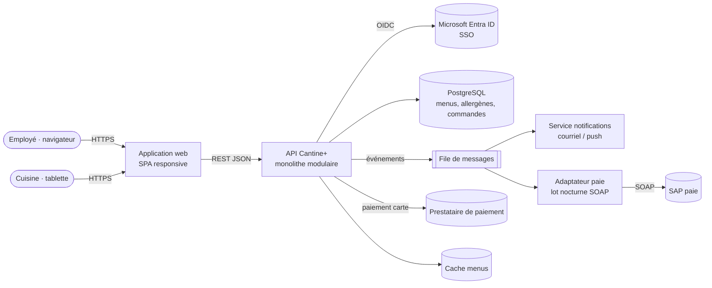

# Architecture · Cantine+ (proposition de corrigé)

Monolithe modulaire (un seul déploiement, modules aux frontières nettes), une base PostgreSQL, une file de messages pour le pic de 10 h 30 et les intégrations.

| Composant | Rôle | Décision clé |
| --- | --- | --- |
| Application web | Menu, commande, code QR, écran cuisine | SPA responsive ; mobile natif plus tard |
| API (modules Menu, Commande, Paiement, Rapport) | Règles métier, heure limite 10 h 30 | Monolithe modulaire (ADR-001) |
| PostgreSQL | Source de vérité des commandes et des **allergènes** | Allergènes versionnés, validation par la diététiste |
| Cache menus | Absorbe les consultations de 8 h 30 | Invalidé à chaque publication du menu |
| File de messages | Lisse le pic de 1 500 commandes ; découple paie et notifications | Traitement asynchrone, réessais |
| Adaptateur paie | Exporte les retenues vers SAP chaque nuit | Anticorruption : SAP n’entre jamais dans le modèle métier |
| Entra ID | SSO, statut permanent / contractuel | Rôles : employé, cuisine, gestion |

## Points de vigilance

- **Allergènes** : donnée à risque légal ; saisie avec double validation, affichage depuis une seule source.
- **Loi 25** : habitudes alimentaires = renseignements personnels ; rapports agrégés, conservation limitée.
- **Pic** : test de charge à 2× le pic avant le pilote.
